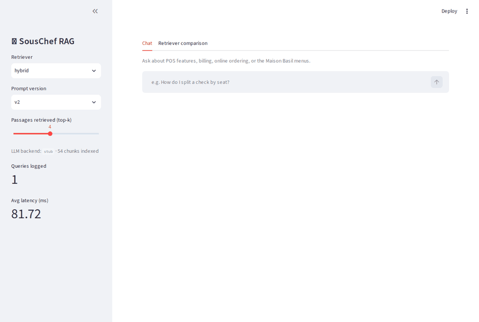

# SousChef RAG: Evaluated LLM Assistant for Restaurant Operations Questions

A retrieval-augmented assistant that answers restaurant-owner support questions from help docs and menus,
with a rigorous automated evaluation harness. Everything runs locally and offline by default.

## Features

- **Ingestion pipeline** – section-aware markdown chunking (with sentence-overlap splitting for long
  sections) and indexing of a synthetic corpus: 10 POS help articles, 2 menus, 2 FAQs (54 chunks).
- **Retriever comparison** – BM25 (own implementation) vs. dense embeddings (FAISS) vs. hybrid (reciprocal
  rank fusion), scored with Recall@K and MRR on a generated gold set (108 in-scope + 14 out-of-scope questions).
- **Prompted generation with citations** – versioned prompts (`v1`, `v2`), numbered context passages,
  `[n]` citations, exact-phrase refusal, and a pluggable LLM backend: deterministic `stub` (default, offline)
  or a local model through **Ollama**.
- **Evaluation harness** – retrieval quality, groundedness (citation validity + claim-overlap per sentence),
  keyword/answer recall, out-of-scope refusal rate and false-refusal rate, plus **prompt-version regression
  tests** (prompt fingerprints + metric baselines) enforced in CI.
- **Streamlit chat UI** showing retrieved sources (cited ones marked) and per-query latency; **FastAPI**
  service; **SQLite** query and eval-run logs.

## Architecture

```
data/corpus/*.md ─► chunking ─► RetrievalIndex ──┬─ BM25
 (generated from                (chunks.jsonl,    ├─ dense: TF-IDF→SVD (LSA) vectors in FAISS
  souschef/corpus_data.py)       dense.faiss)     └─ hybrid: RRF(BM25, dense)
                                      │
 question ─► RagPipeline: retrieve top-k ─► versioned prompt ─► LLM backend (stub | ollama) ─► answer + citations
                                      │                                            │
                              SQLite (queries, latency, eval runs)         FastAPI / Streamlit / CLI
 data/gold.jsonl ─► evaluation harness ─► metrics ─► eval/baseline.json (CI regression gate)
```

```
souschef/        config, corpus(+data), chunking, retrievers, prompts, llm, rag, store, api, cli
souschef/evaluation/   metrics.py (pure functions), harness.py (retriever comparison, regression checks)
app/streamlit_app.py   chat UI          tests/   pytest suite          eval/baseline.json   pinned metrics
```

## Setup

Requires Python 3.10+ (developed on 3.14).

```bash
python -m venv .venv && source .venv/bin/activate
pip install -r requirements-dev.txt
cp .env.example .env        # optional; defaults work without it
```

## Run

```bash
python -m souschef.cli generate-data   # (re)write data/corpus and data/gold.jsonl (already committed)
python -m souschef.cli ingest          # chunk + build BM25/FAISS index into .cache/index
python -m souschef.cli ask "How do I split a check by seat?"
python -m souschef.cli compare         # BM25 vs dense vs hybrid
python -m souschef.cli matrix          # every retriever x prompt-version variant
python -m souschef.cli eval            # full evaluation for every prompt version
uvicorn souschef.api:app --port 8000   # POST /ask, GET /logs /stats /health
streamlit run app/streamlit_app.py     # chat UI
```

The index is built automatically on first use if `ingest` has not been run.
Docker: `docker compose up --build` (API on :8000, UI on :8501).

### Using a real local model

```bash
ollama pull llama3.2:1b
SOUSCHEF_LLM_BACKEND=ollama OLLAMA_MODEL=llama3.2:1b streamlit run app/streamlit_app.py
```

`docker compose --profile llm up` also starts an Ollama container. Optional neural embeddings:
`pip install sentence-transformers` and `SOUSCHEF_EMBEDDING_BACKEND=sentence-transformers`
(needs the model weights; run `ingest` again after switching).

## Test

```bash
python -m pytest                          # unit, API and prompt-regression tests (offline, ~3 s)
python -m souschef.cli eval --check       # same regression gate CI runs
python -m souschef.cli eval --update-baseline   # after an intentional prompt/retrieval change
```

## Results (stub backend, 122 gold questions)

Reproduce with `python -m souschef.cli matrix` (all variants) or `compare` (retrieval only).

**Retrieval** (108 in-scope questions):

| retriever | Recall@1 | Recall@3 | Recall@5 | MRR |
|---|---|---|---|---|
| bm25 | 0.870 | 0.944 | 0.981 | 0.917 |
| dense (LSA) | 0.880 | 0.981 | 0.991 | 0.932 |
| hybrid (RRF) | 0.852 | 0.972 | **1.000** | 0.917 |

**Every retriever x prompt variant** (top-k = 4; `false_refusal` lower is better, the rest higher):

| variant | recall@5 | citation | claim support | grounded | keyword recall | false refusal | OOS refusal |
|---|---|---|---|---|---|---|---|
| bm25 / v1 | 0.981 | 0.982 | 0.982 | 0.982 | 0.678 | 0.019 | 0.929 |
| bm25 / v2 | 0.981 | 0.972 | 0.972 | 0.972 | 0.617 | 0.028 | 0.929 |
| dense / v1 | 0.991 | 0.963 | 0.963 | 0.963 | 0.678 | 0.037 | 1.000 |
| dense / v2 | 0.991 | 0.917 | 0.917 | 0.917 | 0.599 | 0.083 | 1.000 |
| hybrid / v1 | 1.000 | 0.972 | 0.972 | 0.972 | 0.678 | 0.028 | 0.929 |
| hybrid / v2 (default) | 1.000 | 0.954 | 0.954 | 0.954 | 0.603 | 0.046 | 0.929 |

Reading the table honestly:
- Hybrid search raises Recall@5 from 0.981 (BM25) to 1.000, and Recall@3 from 0.944 to 0.972. Dense alone
  is close (0.991 / 0.981) and has the best MRR, so on this small corpus hybrid is a robustness win, not a landslide.
- v2 (stricter prompt: 2 sentences, higher support threshold) is *worse* than v1 on every generation metric
  with the stub, mostly because it refuses more in-scope questions. It is kept as the default only to show
  the regression gate: both versions are pinned in `eval/baseline.json`, and a change that lowers any metric
  by more than 0.02 fails CI. Pick the default per your own backend by running `matrix`.
- With the extractive stub, citation rate, claim support and grounded rate are nearly identical, because every
  sentence it emits is copied from a cited passage; they will separate with a real LLM, where the groundedness
  check has something to catch.
- The gold set is synthetic and written against the same corpus, so absolute numbers are optimistic.

### Failure analysis (hybrid / v2)

Worst cases, grouped by cause:

1. **Out-of-scope leak (1/14):** *"How do I change the oil in my car?"* is answered with unrelated printer and
   permission sentences. "change" and "car"/"check" overlap enough with the context to clear the stub's
   lexical `min_support` gate. A real model or an embedding-similarity gate would catch it.
2. **False refusals (5/108):** paraphrases that share few terms with the source, e.g. *"How do I combine two
   checks into one?"* (doc says "merge"), *"How can I make the kitchen display more reliable?"* (doc says
   "KDS" / "freezes"), *"Is there a vegetarian main course at Maison Basil?"*. Fewer than half of the question's content words appear in the context, so v2's 0.5 threshold trips; v1 (0.34) refuses only 3.
3. **Retrieval misses (rank > 3):** *"How do I add a new server to the system?"* ranks the menu-item article first
   ("add a new ... item") instead of *Adding an employee*; *"What happens when my terminal comes back online?"*
   ranks online ordering first. Both are vocabulary mismatches ("server" the person vs. a generic word, "online").
4. **Low keyword recall (mean 0.60):** the stub scores sentences by term overlap across *all* retrieved passages,
   so a generic word like "check" or "kitchen" can pull a sentence from a neighbouring article
   (*"How do comps work?"* cites the subscription-plan sentence). Retrieval was right; sentence selection was not.

## Demo



45-second recording of the real Streamlit UI (answer with `[n]` citations, expandable cited sources, per-query
latency, and a refusal on an out-of-scope question). Regenerate with `scripts/record_demo.py` (dev-only; needs
`playwright` and `pillow`).

## Summary line

> Built and evaluated a RAG assistant (hybrid retrieval, FAISS, local LLM); hybrid search raised Recall@5 from
> 0.98 (BM25) to 1.00; CI-gated groundedness regression tests.

## Key design decisions

- **Offline by default.** The stub LLM is an extractive, deterministic backend that follows the prompt
  contract (parses `[n]` passages, refuses when too few question terms are supported, cites each sentence).
  It reads `max_sentences` / `min_support` from the system prompt's `Settings:` line so prompt versions change
  its behaviour measurably. It validates the *pipeline and harness*, not LLM quality; use Ollama for that
  (model-dependent output makes `--update-baseline` refuse to run on non-stub backends).
- **"Dense" embeddings are LSA by default** (char n-gram TF-IDF → truncated SVD → FAISS inner product) so
  no model download is needed; sentence-transformers is a drop-in alternative behind the same interface.
- **Relevance is judged per section** (`doc_id#heading`), so splitting a long section into chunks never
  penalises retrieval.
- **Groundedness without a judge model:** every sentence needs a valid citation, and ≥70% of its content
  terms must appear in the cited passages. It is a lexical proxy and cannot catch subtle paraphrased errors.
- **Prompt regression:** each prompt's SHA-256 is pinned in `eval/baseline.json`; editing text without
  re-baselining fails, and metric drops beyond a 0.02 tolerance fail CI.
- **Known limits:** ~1 in 14 out-of-scope questions leaks through the stub's lexical refusal check; the
  persisted embedder is a pickle of our own artefact (never load index files from untrusted sources).
- Configuration is environment-only (`.env.example`); no secrets are needed anywhere.
